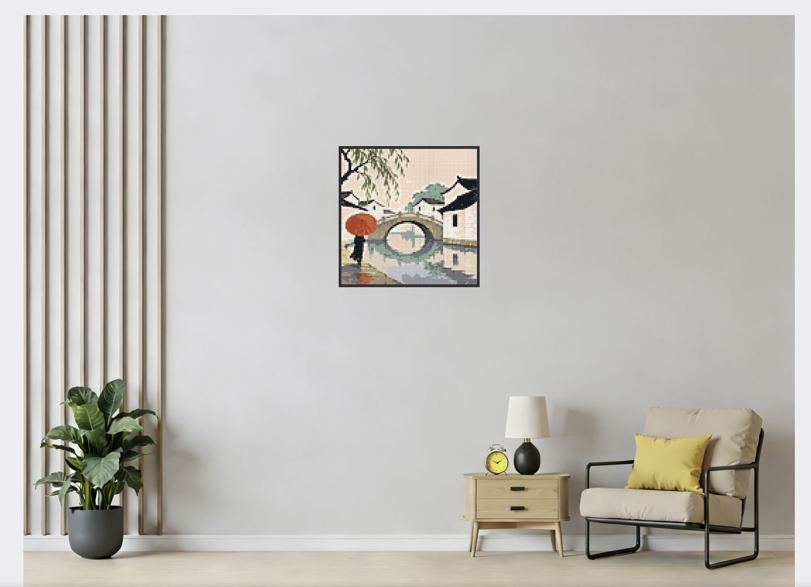
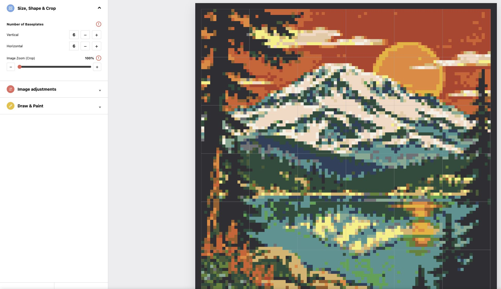
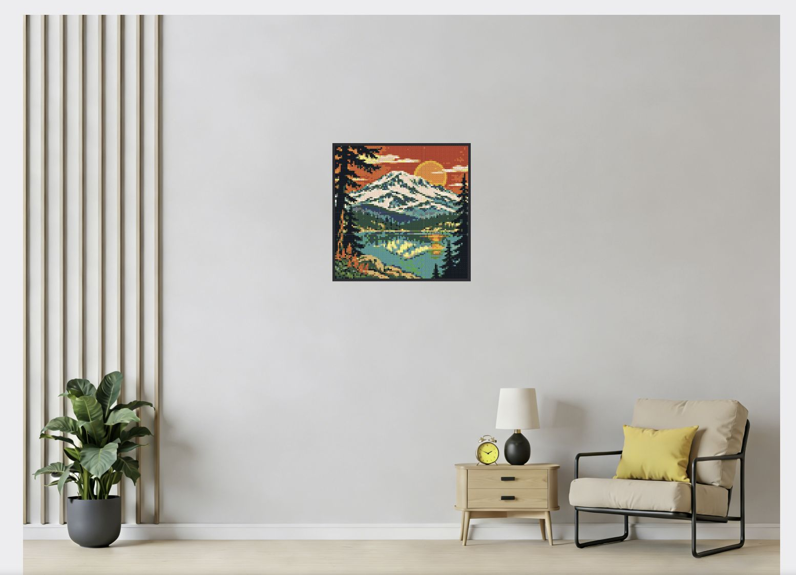
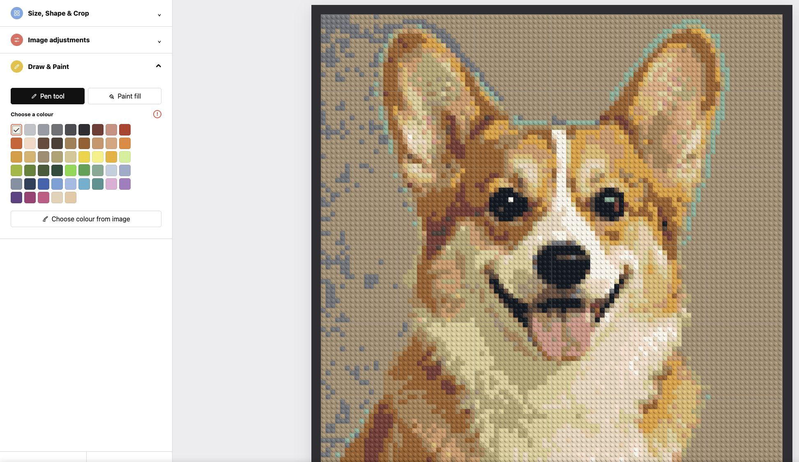

  

# MosaicMint

**Turn a customer's photo into a brick mosaic order your workshop can actually make.**

[View MosaicMint on the Shopify App Store](https://apps.shopify.com/mosaicmint) · [Product site](https://mosaicmint.echodare.app) · [Support](https://mosaicmint.echodare.app/support)

MosaicMint is a Shopify app for merchants selling made-to-order brick mosaics.
It puts a guided creator on selected product pages and keeps the customer's
design connected to the order and its production files.

## Why I built it

For a custom mosaic seller, collecting an uploaded image is only the start.
The buyer needs to see how the image translates into bricks. The seller then
needs to know which colors, sizes, baseplates, and layout the buyer approved.
If those decisions are scattered across messages and spreadsheets, every order
needs manual reconstruction.

MosaicMint connects those steps: shoppers design and preview a mosaic in the
storefront; merchants set the factory palette and product rules; ordered designs
retain the information needed for assembly and fulfillment.

## See it in action

These are sample editor and wall-preview images using original demonstration
artwork. Wall previews illustrate appearance and scale; they are not photos of
manufactured products or customer orders.

### Jiangnan street scene

| Edit the mosaic | Preview it on a wall |
| --- | --- |
|  |  |

### Vintage mountain lake

| Edit the mosaic | Preview it on a wall |
| --- | --- |
|  |  |

### Corgi portrait

| Edit individual bricks | Preview it on a wall |
| --- | --- |
|  |  |

## From product setup to production

1. **Set up the product.** Choose a Shopify product, permitted mosaic sizes,
   factory color codes, frame options, and pricing rules.
2. **Let shoppers create.** They upload an image, crop and adjust it, choose
   colors, paint individual bricks, and preview the result before adding it to
   the Shopify cart.
3. **Keep the approved design.** The order retains its design snapshot rather
   than leaving the workshop with only an image upload.
4. **Prepare the build.** View the assembly overview, numbered baseplate
   guides, color counts, bill of materials, and CSV downloads in the app.

MosaicMint uses Shopify's product page, cart, and checkout flow. The current
plan and trial details are shown on the
[Shopify App Store listing](https://apps.shopify.com/mosaicmint).

## 中文简介

MosaicMint 面向销售定制积木颗粒画的 Shopify 独立站。顾客在商品页上传照片、
调整颜色和尺寸、逐颗修改并预览上墙效果；商家配置工厂色号与尺寸规则，
订单保留设计快照，并提供总览图、分板安装图、颜色统计和生产文件。

[前往 Shopify 应用商店查看 MosaicMint](https://apps.shopify.com/mosaicmint)

## About this repository

This public repository contains the MosaicMint product introduction and sample images only. The application source code is kept separately.
